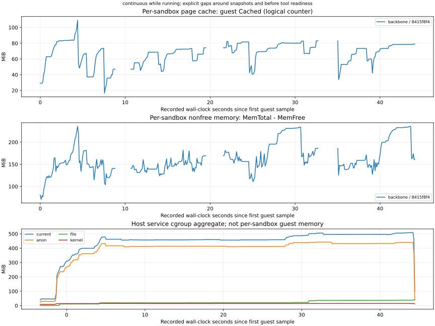
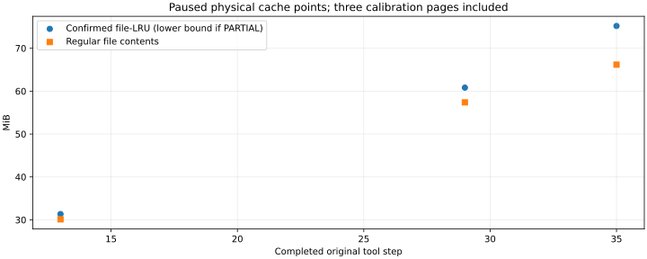
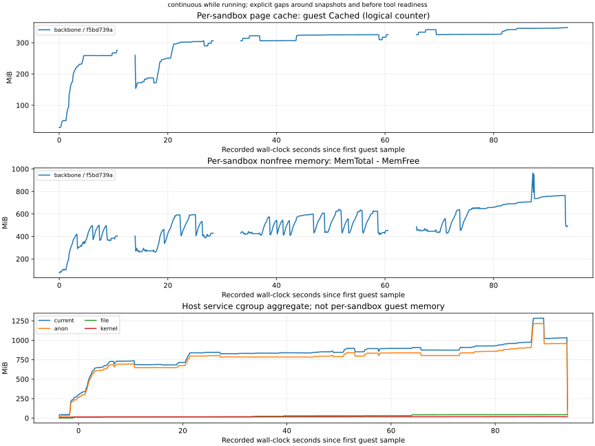
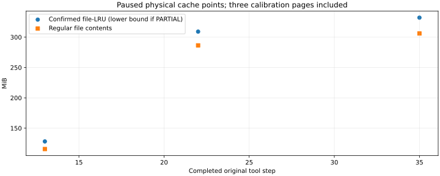

# Sphinx / Xarray：完整任务与物理缓存报告

2026-10-11，第4步的运行、采集和报告流程已完成。两个任务各完整执行35个冻结动作，并在三个原步骤边界测量物理缓存；默认内存、CPU、I/O及host进程曲线持续采集，自动报告独立复算一致。Sphinx三点物理映射完整；Xarray两点各有一页未知，作为已确认下界及最多4 KiB的缺口保留，没有重跑以追求零未知。

## 任务与测量结果

| 任务 | 测量步骤 | 已确认文件缓存物理量（MiB） | 普通文件内容（MiB） | 块设备缓存（MiB） | 分配元数据（MiB） | 未知量上限（KiB） |
| --- | ---: | ---: | ---: | ---: | ---: | ---: |
| Sphinx #7590 | 13 | 31.35 | 30.12 | 1.23 | 0.00 | 0 |
| Sphinx #7590 | 29 | 60.82 | 57.38 | 3.42 | 0.02 | 0 |
| Sphinx #7590 | 35 | 75.19 | 66.17 | 8.99 | 0.03 | 0 |
| Xarray #6992 | 13 | 128.17 | 115.61 | 9.88 | 2.69 | 0 |
| Xarray #6992 | 22 | 309.16 | 286.52 | 19.95 | 2.70 | 4 |
| Xarray #6992 | 35 | 332.18 | 306.11 | 23.37 | 2.70 | 4 |

1 MiB = 2²⁰ bytes，1 KiB = 1024 bytes，页大小4096 bytes。Xarray第22、35步各有一个guest文件页未取得host物理页号；报告的完整数值区间分别为`[324177920, 324182016]`与`[348319744, 348323840]` bytes。已知三页校准文件的归属、内容和物理映射均通过，未知页没有混入已确认量。每点包含12 KiB校准内容，测量后释放。

测量范围与Prettier三点报告一致：暂停点guest文件页在host上的实际驻留，按物理页号去重，普通文件、块设备页及文件系统分配元数据分开。不覆盖全部host镜像缓存、DAX或VMM PSS；本次各一个实例，没有跨实例共享比较。各任务镜像、动作和初始缓存不同，不用此表推断哪个后端或缓存策略更快。

## 持续曲线与阶段耗时

| 任务 | guest持续样本 | 非空闲内存观测峰值（MiB） | Cached观测峰值（MiB） | 原工具执行之和（秒） | 冷启动请求（秒） | 精细分析之和（秒） | 其中VM暂停（秒） | 控制器生命周期（秒） |
| --- | ---: | ---: | ---: | ---: | ---: | ---: | ---: | ---: |
| Sphinx | 374 | 235.73 | 109.30 | 11.301 | 2.522 | 20.455 | 6.308 | 48.145 |
| Xarray | 789 | 965.50 | 348.30 | 34.018 | 2.848 | 28.399 | 13.499 | 98.013 |

非空闲内存为guest `/proc/meminfo` 的`MemTotal−MemFree`；Cached是逻辑计数，并包含与Shmem重叠的部分。Slab、AnonPages、Buffers、Shmem及峰值时组成和占比保存在统一报告中。host cgroup及对应VM进程的CPU/I/O/RSS/PSS单列，不与guest指标或物理量相加；RAM准备缓存不在服务cgroup归属内。采样最大值称观测峰值，VM暂停期间没有新增样本，采样空档保留在原始时间戳中。

精细分析时间包含准备、暂停和释放，暂停时间是其子集；生命周期已经包含工具、测量、测试及清理，不能把各项再相加。两次没有checkpoint/restore，不重复已有恢复验证。新配置包含精细暂停，不使用Prettier轻量采样五对的百分比描述本次成本。









CPU、I/O和host进程曲线：[Sphinx](evidence/sphinx-performance-20261011.svg)、[Xarray](evidence/xarray-performance-20261011.svg)。

## 正确性和原任务结果

动作哈希、顺序、预期失败探索、关键输出、最终源码和完整patch均按原规则核验。Sphinx沿用获批管道规则版本2，Xarray沿用获批SIGPIPE规则；两个诊断完成状态均PASS，严格重放状态仍FAIL，没有扩大退出码例外。

独立任务评测与原参考逐项一致：Sphinx25项中24通过、1失败、0跳过；Xarray957项中945通过、12失败、0跳过。失败集合、F2P/P2P计数保持，不把平台采集通过当作模型修复成功。每次物理分析前后源码及完整git patch相同。

## 复现、清理与证据

```bash
bash scripts/use-platform.sh run configs/platform-sphinx7590-cache.json
bash scripts/use-platform.sh run configs/platform-xarray6992-cache.json
```

两条命令顺序执行，使用固定2 CPU/4096 MiB VM和8 GiB临时卷，启动要求至少34 GiB可用空间；温热镜像在有界RAM中准备，不清host/guest缓存。已有结果足够回答本阶段问题，无需重跑。

| 任务 | 成功入口 | 自动报告 | 独立复算 |
| --- | --- | --- |
| Sphinx | `.artifacts/platform-tasks/20261011T110349Z-605616` | `.artifacts/platform-tasks/report-20261011T110349Z-605616` | `.artifacts/platform-tasks/report-sphinx-cache-recomputed-20261011` |
| Xarray | `.artifacts/platform-tasks/20261011T110646Z-665078` | `.artifacts/platform-tasks/report-20261011T110646Z-665078` | `.artifacts/platform-tasks/report-xarray-cache-recomputed-20261011` |

两项任务的10份自动报告分别与独立复算逐字节一致，合计1,186份原始文件哈希未变。原任务测试结果另与历史参考核对。代码版本、镜像digest、输入哈希、实际步骤、内存组成、时延、测量范围和清理回执保留；[公开证据](evidence/python-task-cache-20261011.json)只含摘要，原PFN、日志、凭据和镜像不上传Git。

两次本次VM、私有服务、采集器、BPF探针、挂载、loop、成功卷及RAM准备缓存均回收，原服务和VM身份不变。卷内占用观测峰值分别0.915/0.984 GiB，主机最小空闲分别30.05/29.27 GiB；这是磁盘值，不是内存或瞬时精确峰值。本轮没有新增失败卷，也未删除历史任务输入。

Prettier、Sphinx、Xarray的共同测量流程现已具备；Xarray物理完整性缺口明确为每个相应边界最多4 KiB。下一步第5项优先整理本机部署前提、模板/checkpoint查询及保留，再接入一条在线工具轨迹导出和冻结重放，不追加重复长测。
