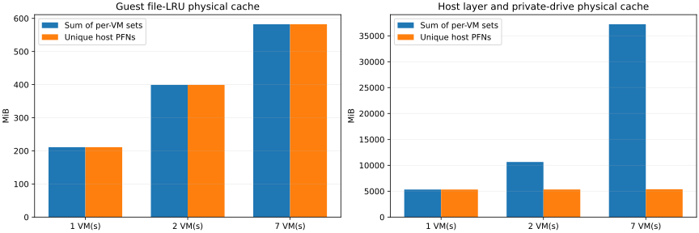

# Prettier #6604：共享缓存计数

2026-10-11，第3阶段完成：共享、私有和写时复制计数校准通过，单实例、双实例及七实例各有一次完整任务、物理缓存测量和持续曲线通过的结果。此前七实例的校准探针问题已修复，原失败记录保留。本阶段验证计数、正确性和数据完整性，没有追加统计性能轮数。

## 配置与实际结果

使用同一固定镜像、冻结动作和已转换缓存，每个VM为2 CPU、4096 MiB。三份`platform-prettier6604-shared-N.json`配置分别选择backbone、backbone加early_1、全部七条路径。各实例完成原前11步后等待，逐个准备探针并暂停，全部暂停后核验guest内核、实际RAM映射及host物理页号，再继续原后缀。

| 实例数 | 完整原动作 | guest文件缓存物理量（MiB） | host镜像及私有盘缓存物理量（MiB） | host按实例相加的重复量（MiB） | 分析耗时（秒） | 控制器生命周期（秒） |
| --- | ---: | ---: | ---: | ---: | ---: | ---: |
| 1 | 29 | 211.07 | 5317.24 | 0.00 | 15.797 | 40.851 |
| 2 | 50 | 399.22 | 5330.52 | 5308.07 | 24.867 | 52.908 |
| 7 | 189 | 582.21 | 5375.69 | 31848.40 | 62.978 | 100.263 |

物理量按host物理页号去重，1 MiB = 2²⁰ bytes，页大小4096 bytes。三次成功测量未知guest映射页、未确认host backing页及guest/host集合交叠均为0。每个guest结果包含12 KiB已知校准文件内容；七实例修正版用共享映射及mlock固定这三页，测量结束后释放，旧单/双实例未固定。任务文件和缓存策略不变，代码版本差异保留，不用于采集开销因果比较。

七实例共享镜像层为5308.07 MiB，私有可写层合计67.63 MiB；直接将每个实例关联的层缓存相加会多计六份共享层，即31848.40 MiB（31.10 GiB）。七个guest文件缓存集合没有重复的host物理页：共享底层镜像没有使本次guest文件缓存自动共享。这是计数结果，不是与其他后端比较所得的内存节省。

实际测量的镜像层是从RAM准备缓存复制到本次ext4临时卷的文件，包含层格式和元数据；另外的RAM准备缓存不在这些物理集合内。旧单/双实例raw摘要误写成RAM种子，原文件保留，离线报告与公开摘要已更正。provider匿名缓冲、非LRU的guest内容和整机其他内存未计入；guest逻辑内存、VMM PSS和物理缓存量分别报告，不相加。



## 任务、持续曲线及测量影响

三个配置分别完成29、50、189个冻结动作。动作哈希、顺序、原退出码、关键输出、最终源码/patch及独立性质检查通过；七条路径原官方测试仍各0通过、2失败，平台重放通过与模型修复失败分别记录。

单实例有276个guest持续样本，双实例为329/351个；七实例各有601–726个。自动报告包含各沙箱内存、CPU、I/O及对应host进程曲线。guest工具时间按路径另列，不把并发调用之和当端到端用时。七实例冷启动请求跨度2.965秒，分析62.978秒，控制器生命周期100.263秒；后者已包含分析、等待、任务测试和清理，各项不能重复相加。

相同工具边界不保证相同驻留量：各实例准备和等待时间不同，guest内存回收仍可能在暂停前发生。七实例各沙箱的物理缓存约29.53–211.62 MiB，总量582.21 MiB；不能用它与单实例211.07 MiB直接推断并发节省。分析阶段会暂停VM，成本已经量化，不能沿用轻量采样五对的开销结论。本阶段不是冷缓存、page cache控制或性能因果比较。

## 校准与修复

复用16 MiB host校准：两个进程共享文件去重16 MiB；两个私有文件32 MiB；第二个映射半数页写时复制后，文件16 MiB加匿名8 MiB；写后复制到不同inode为32 MiB。新聚合方法按保存的物理页记录复算一致。此校准是host已知负载，不是DAX或VM恢复校准。

首次双实例在校准页的LRU标记检查失败；改为逐个准备后立即暂停后，双实例通过。首次七实例同样在LRU检查失败。新增固定页版本又被“立即UNEVICTABLE”检查拒绝，该要求不正确；此外，[Linux 6.1.175源码](https://github.com/gregkh/linux/blob/v6.1.175/mm/gup.c)显示私有可写映射的mlock可能触发匿名复制。失败断言前未保存详细页信息，不把其中一种机制称为唯一已证实原因。

修正版使用共享文件映射，并按VmLck（进程锁定内存计数）的增量核对12 KiB，不要求立即出现UNEVICTABLE；暂停点的文件归属、内容、LRU和host物理页检查保持。14项回归通过，随后七实例正式运行通过，未知映射零。没有放宽原轨迹或物理计数条件。

三次成功运行的本次VM、私有服务、BPF探针、挂载、loop和RAM准备缓存全部回收，原服务及VM身份保持。七实例卷内观测占用峰值6.42 GiB，主机最小空闲26.57 GiB；成功16 GiB临时卷已自动回收。

## 复现与证据

```bash
bash scripts/use-platform.sh run configs/platform-prettier6604-shared-1.json
bash scripts/use-platform.sh run configs/platform-prettier6604-shared-2.json
bash scripts/use-platform.sh run configs/platform-prettier6604-shared-7.json
```

三条命令顺序执行，单次16 GiB卷要求至少42 GiB主机可用空间。日常无需重复本轮成功实验；优先用原始结果离线复算。

| 内容 | 本机证据位置 |
| --- | --- |
| host校准 | `.artifacts/file-physical-calibration/20261011T071042Z-475656` |
| 单实例成功入口 | `.artifacts/platform-tasks/20261011T071641Z-477959` |
| 双实例成功入口 | `.artifacts/platform-tasks/20261011T072954Z-489484` |
| 七实例成功入口 | `.artifacts/platform-tasks/20261011T084711Z-538571` |
| 七实例原始数据 | `.artifacts/storage-isolated-service/20261011T084829Z-540217/prettier6604` |
| 七实例自动报告与曲线 | `.artifacts/platform-tasks/report-20261011T084711Z-538571` |
| 三配置离线比较 | `.artifacts/platform-tasks/shared-comparison-20261011-complete` |
| 独立复算 | `.artifacts/platform-tasks/shared-comparison-recomputed-20261011-complete` |
| 复算检查 | `.artifacts/platform-tasks/shared-cache-review-20261011/completed-result.json` |
| 失败诊断及清理回执 | `.artifacts/platform-tasks/shared-cache-review-20261011` |

两次离线生成的5份文件逐字节一致，3,540份raw哈希未变；直接从物理页记录重算，并核验任务正确性和校准证据。公开摘要见[证据](evidence/shared-task-cache-20261011.json)，原PFN、日志和镜像不上传Git。

本轮经用户授权删除最新失败16 GiB源卷、上一份七实例2.084 GiB完整备份，以及已被后续证据取代且不作为输入的旧Xarray 3.529 GiB镜像，共回收21.61 GiB；全部原始记录保留，最新七实例2.074 GiB完整失败备份和当前任务输入镜像保留。后续同类清理按用户自动处理授权执行，记录实际删除范围和哈希。

下一步进入第4项，将同一物理测量和持续报告流程用于Sphinx、Xarray；不重跑已成功Prettier，不追加性能统计轮数。
