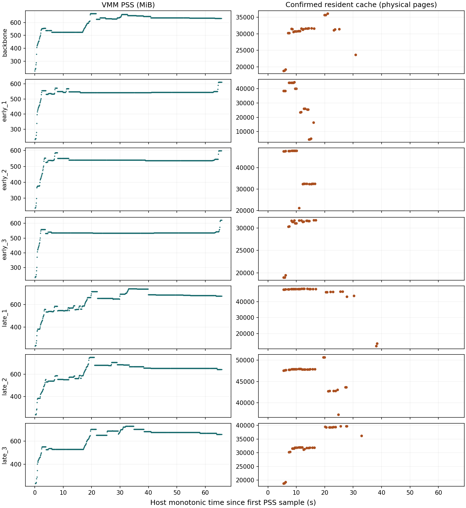

# Prettier GRPO：冷启动逐动作测量首次实跑

**失败，止于第一个业务动作之前。** 七个独立沙箱都已冷启动；缓存会话和 PSS 绑定代码争用同一个角色输出目录，绑定未完成。未补跑。业务动作 0/189，逐动作缓存点 0/189，逐支 PSS 点 0。这里的 0 是取得的点数，不是物理页数。

## 量与边界

每个缓存点要测的是**该沙箱 RAM 内、VMM 映射中、经前后 guest 清单核对确认的缓存物理页数**。同一宿主物理页在该支内只计一次；它是宿主缓存成本的下界，不含宿主侧后备文件副本。未确认的 guest 页数独立记录，不当成零，不加入确认数。本批没有走到读页，两项数值均缺失。

冷启动会话的 RAM 直接后备查询是**未接线**：现有 `LiveTaskCache._start_snapshot_queries` 不为 `parent` 会话构造后备查询器，并非实测证明后备副本不存在。本批指标和查询用时均不与恢复场景的四来源并集比较。

## 停止原因：身份回执目录与会话目录重名

1. `sandbox-ids.tsv` 有七个不同的 ID，均为新建根实例；七次冷启动命令均返回成功。
2. `ColdPoints.prepare` 以角色名创建 `LiveTaskCache(session_name=role)`，提前占用 `live-cache/<role>/`。随后 `run_guest_light_memory.bind_vmm` 在同一路径调用 `mkdir(parents=True)`，要求目录尚不存在，才会写身份回执。七个角色目录都有会话代码，但都没有该身份回执。
3. 控制器的 `joined` 等待已派出的创建操作收尾，最终报告 `FileExistsError(17, 'File exists')`。日志未保留首个抛错者的角色名，不能根据返回顺序指定“首个失败支”。此次冲突在宿主采集输出目录，不是设备服务的槽位冲突。
4. `segments.tsv` 只有表头，未派发业务段，未发出逐动作暂停请求。轻量采样器写了 20 轮，所有轮次均未绑定任何角色；采样线程正常退出不是 PSS 曲线验收通过。

## 逐支核对

| 角色 | 目标动作点 | 已采／缺失 | PSS 点 |
|---|---:|---:|---:|
| backbone | 29 | 0／29 | 0 |
| early_1 | 21 | 0／21 | 0 |
| early_2 | 21 | 0／21 | 0 |
| early_3 | 21 | 0／21 | 0 |
| late_1 | 32 | 0／32 | 0 |
| late_2 | 32 | 0／32 | 0 |
| late_3 | 33 | 0／33 | 0 |

各支点数不足均因上述绑定失败。没有观测点可检查是否串支，PSS 实际周期与最大间隔也无有效值。[逐支 CSV](roles.csv) · [离线读取脚本](read-run.py)。

## 耗时与业务验收

| 项目 | 本次结果 |
|---|---|
| 失败尝试的控制器墙钟 | 3.276458467 秒，含初始化、已派出的创建请求及控制器收尾；不是完整 rollout 墙钟。 |
| 工具业务、逐动作缓存核对、累计暂停 | 均未执行，工具执行和累计暂停均为 0 秒；没有单点查询耗时，也没有段末同步等待。 |
| 其他测量准备 | 发生了探针挂载和空轮采样，与创建并行；没有单独的净墙钟。不能把控制器墙钟当作纯业务时间或将其拆作完整 rollout 的开销。 |
| 业务补丁与官方检查 | 本次均未产生，无法逐项比对。不是官方检查失败，也不是暂停改变了工具结果；是业务前采集初始化失败。 |

启动器与调度入口预算均通过；GRPO 开跑前可用 132,654,030,848 字节，严格大于所需 45,097,156,608 字节。沙箱列表已清空，私有容器、挂载、loop 和实验 slice 已撤下；失败卷按策略保留。启动器退出码 1。

原始证据：`.artifacts/storage-isolated-service/20261121T145622Z-1688803/prettier6604/` 的 `failure.txt`、`result.json`、`sandbox-ids.tsv`、`segments.tsv`、`light-memory.jsonl`、`live-cache/`；外层 `result.json` 保存清理状态。调用与预算在 `.artifacts/grpo-per-action-20261121T145501Z/`。此前 [离线验证](OFFLINE.md) 的单段补丁和放行时间戳仍有效，但不算本次业务测量。

**下一步建议（未执行）：** 将缓存会话放在独立名字下，例如 `live-cache/<role>-g1/`，保留 PSS 身份回执的排他创建。先离线验证同一角色能顺序完成会话准备、身份回执写入和 PSS 注册，并且重复注册仍会失败；通过后再安排一次完整实跑。

## 目录修复后的完整实跑：通过，189/189 个动作有核对点

**一次完整 Prettier GRPO 已跑完，没有重试。** 七支都有 PSS 时间序列；缓存点与原动作逐一匹配，无缺失、重复或串支。各支最终补丁与历史冻结轨迹的末段补丁逐字节一致；官方检查按角色逐项一致（仅排除每次运行必然不同的开始时间）。原期望是每支 0 个测试通过、2 个失败；本次保留了相同的测试项及失败结果。

**目录归属与离线回归。** PSS 身份回执仍由绑定程序排他创建在 `live-cache/<角色>/`；本轮冷启动缓存会话改用 `action-points/live-cache/<角色>/`。未改 PSS 创建语义或其他会话的目录。下表五项在临时目录调用实际目录写入代码，仅模拟 VMM 身份与探针，不启动沙箱。自检命令：`python3 -B docs/records/grpo-per-action-20261121/check-directories.py`。[测试输出](fixed/regression.txt)

| 回归 | 实际结果 |
|---|---|
| 先缓存，后 PSS | 两套文件均保留，通过 |
| 先 PSS，后缓存 | 两套文件均保留，通过 |
| 同角色再次绑定 PSS | 原样抛出 FileExistsError，通过 |
| 同角色再次建立缓存会话 | 原样抛出 ValueError，不覆盖原会话，通过 |
| 计划外角色 | 合法名称可建目录，但不能成为本轮有效 PSS 角色，采样器仍拒绝激活，通过 |

### 每支测到了什么

左列曲线为各 VMM 的 PSS（驻留内存，共享页按比例分摊），右列为每个动作后实际核对的缓存页，横轴是同一宿主时钟。缓存点取实际读窗起点，不把它当成工具结束瞬间，也不拟合点间变化。

| 角色 | 缓存实收／应收 | PSS 点数 | 实际周期间隔中位数 ms | 最大间隔 ms | 本支累计暂停 s |
|---|---:|---:|---:|---:|---:|
| backbone | 29/29 | 652 | 100.073 | 282.749 | 1.732 |
| early_1 | 21/21 | 651 | 100.018 | 313.205 | 1.175 |
| early_2 | 21/21 | 651 | 100.069 | 287.715 | 1.470 |
| early_3 | 21/21 | 651 | 100.041 | 294.922 | 1.346 |
| late_1 | 32/32 | 651 | 100.030 | 307.370 | 2.115 |
| late_2 | 32/32 | 650 | 100.028 | 318.737 | 2.168 |
| late_3 | 33/33 | 650 | 100.018 | 322.209 | 2.000 |

每点均用冻结清单核对动作次序，并核对原始 guest 通知、放行标记的角色／段／步号、工具结束时刻，以及身份回执中的沙箱 ID 和宿主 PID。工具结束用 guest 单调时钟；暂停、恢复、读取、放行用宿主单调时钟，两种时钟不直接相减。[逐动作明细](fixed/points.csv) · [逐支 PSS 原点](fixed/pss.csv) · [逐支验收](fixed/roles.csv)。

**冷启动口径。** 各点确认 **4,594–50,649 个宿主物理页**：只计该沙箱 RAM 内、VMM 映射中、前后缓存清单身份一致且宿主页号稳定的页，按物理页去重。它是宿主缓存成本的下界，不包含宿主侧后备文件副本。另有 **0–186 个未确认 guest 页／点**，按实际值单列，不加入确认数。直接后备查询在冷启动会话中**未接线**，并非已证实不可用；冷启动无恢复快照，快照内存下层和对应 provider 不适用。页数和用时均不与恢复四来源查询对照。

### 墙钟、暂停与测量分别计时

| 指标 | 实测值 | 边界与读法 |
|---|---:|---|
| 完整 rollout 墙钟 | **66.363 s** | 从启动七支业务流程至完成官方检查；包含期间发生的测量。控制器若从初始化计至清理完毕为 72.550 s。 |
| 逐动作测量窗口 | **15.445 s** | 从宿主收到动作就绪到放行调用返回，所有窗口重叠只算一次；若逐支累加为 34.266 s。不含此前收到通知的延迟、启动探针或后台 PSS 采样。 |
| 实际暂停总时长 | **12.005 沙箱·秒** | 各支从暂停完成至发出恢复请求逐次累加；按宿主时间取并集，有至少一支暂停的时间为 **8.456 s**。暂停已含在测量窗内，不重复相加。 |
| 原业务工具耗时 | **78.445 沙箱·秒** | 冻结 runner 在各动作命令前后计时，逐支累加，不含动作结束后的核对等待。并发执行，故不是墙钟。 |

按宿主时间分开：逐动作测量窗口并集 **15.445 s**，其余窗口 **50.918 s**，合为 **66.363 s**。一支暂停时其他支可继续运行，不能把 15.445 s 全算成新增延迟，也不能把 50.918 s 称为关闭采集后的业务墙钟。七支各自跑完自己的路径才汇合，未设置逐段全局等待。[纳秒级耗时字段](fixed/timing.json)

原始批次：`.artifacts/storage-isolated-service/20261121T150333Z-1693930/prettier6604/`；历史业务对照：`.artifacts/storage-isolated-service/20261107T084731Z-3799106/prettier6604/`。启动器 `.artifacts/grpo-fixed-action-20261121T150214Z/` 退出码 0；入口可用 115,234,996,224 字节，超过本次卷预算门槛 45,097,156,608 字节。

下一步建议：如果需要回答“采集实际拖慢任务多少”，另做同配置、不插入逐动作测量的一次业务对照，先核对补丁和官方结果，再比较同一边界的 rollout 墙钟。本轮没有追加对照。

## 采样缺口与暂停窗口

**PSS 曲线可以用于汇报，但应标出启动空白和两处稀疏区间。** 189 个动作后缓存点到同支最近 PSS 点的时间差，中位 **27.171 ms**，最大 **55.622 ms**，没有一个超过标称周期。实测没有显示暂停附近出现整周期的系统性缺口；不能据此断言采集本身毫无影响。

### 少于约 663 个点，不等于中途漏了十余轮

以 rollout 开始为 0 秒。66.363 秒除以标称 0.100 秒，得到约 663 个**周期**，不是每支都应收到的固定时间戳清单。采样器按轮顺序读已绑定的角色，不追补过期时刻。七支的首个 PSS 点落在 **0.990–1.228 秒**；完整 PSS 文件又采到 rollout 结束后 **0.338–0.416 秒**。因此，650–652 是全部有效点数，严格截在 rollout 内则是每支 **647–650 点**。每支从首次到末次观测的轮号都逐一连续，没有中间漏写某个轮号。

为区分轻微抖动和明显空档，以相邻 PSS 起点相隔 **至少 200 ms** 为稀疏区间（超过 100 ms 的全部间隔另见下表）。全序列共 14 个，每支两处：

- **5.694–6.064 秒**：七支各一次。这是各支区间合起来的外边界；最长为 late_3 的 5.742–6.064 秒（322.209 ms）。最早一次暂停完成在 6.464 秒，这组空档发生在它之前。
- **66.332–66.714 秒**：七支各一次，跨过或落在 rollout 终点附近。最后一次暂停在 39.434 秒已发出恢复请求。它们也不是动作核对期间的空档。

### 暂停相交时略长，但最长的间隔不在暂停期间

用已经画在图上的宿主时间戳：同支相邻两个 PSS 读取起点之间为一个间隔；与本支任一“暂停完成→发出恢复请求”有正时长交集就归入相交组。这不是说整个间隔都处于暂停。以下覆盖整张曲线（含收尾），以间隔为单位，每个间隔只计一次。

| 与本支暂停窗口的关系 | 间隔数 | 中位数 ms | 最大 ms | 严格超过 100 ms | 至少 200 ms |
|---|---:|---:|---:|---:|---:|
| 相交 | 305 | 101.109 | 156.458 | 188/305（61.64%） | 0 |
| 不相交 | 4,244 | 100.048 | 322.209 | 2,305/4,244（54.31%） | 14 |

相交组中位数只长约 **1.06 ms**。较长间隔本身也更容易与暂停窗口相交；七支又共享一个顺序采样线程，不能把这些间隔当作互相独立的暂停实验。改用“任一支暂停”分类，结论不变：1,034 个相交间隔最大 156.458 ms，其余 3,515 个最大 322.209 ms。

### 缓存点怎样配最近的 PSS

逐个用缓存的宿主页表**读取起点**匹配同角色最近的 PSS **读取起点**，用绝对时间差统计；不用另一支的 PSS 或 guest 的工具结束时间补点。189 个点中，差值最大的是 **late_1 的第 2 个动作**，最近的 PSS 在缓存点之后 **55.622 ms**。即使改用缓存读窗中点与实际 PSS 扫描中点，差值中位也仅 **24.142 ms**、最大 **59.851 ms**。本批不需要给个别动作加“超过一个周期”警示；图注应写“最近实测点，非同时读数”，不据此补画间隔内的峰值。

**能解释到哪一步。** 原始 `light-memory.jsonl` 有每轮开始、结束和采样线程 CPU 时间。第 62 轮结束到第 63 轮开始相隔约 182 ms；第 665 轮本身用了 264 ms 墙钟，其中线程 CPU 为 91 ms。前者包含轮间等待，后者说明慢轮的墙钟不全是该线程在 CPU 上执行的时间。现有字段不能区分休眠后延迟唤醒、等锁或其他等待，也没有同负载无测量对照，不能归因于 GIL 或断言无采样扰动。

[逐间隔及逐动作对照 CSV](fixed/pss-gap-comparison.csv)：`interval` 行列出 4,549 个间隔的宿主起止、相对 rollout 时刻、本支及任一支暂停相交标志、前一轮墙钟与 CPU；`cache_point` 行列出 189 个缓存点、相邻 PSS 区间与最近点偏差（正号表示 PSS 在后）。来源为本批 `fixed/pss.csv`、`fixed/points.csv`、原始 `light-memory.jsonl` 与 `result.json`，仅离线核对。
