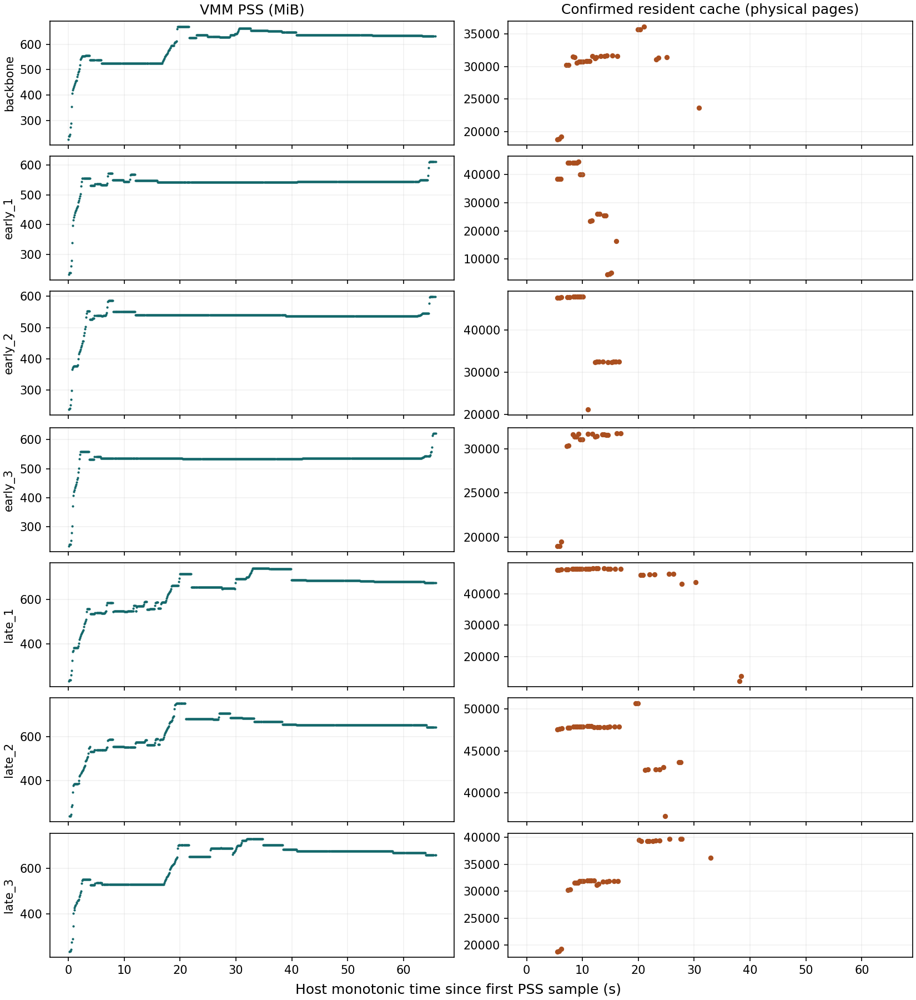

**恢复快照后，暂停查询在同一快照的五批实测中都于 1 秒内交付了结果（`cad1058`）；在冷启动的 Prettier 完整任务中，七个沙箱都有内存曲线，189 个工具动作也各有一个缓存核对点（`ffcb614`）。**

# 沙箱内存怎么测：恢复点校准与完整任务曲线

基线：`handoff-20261118`（`dd9ba4c`）。本篇取代旧串行简版（`eb63579`）用于汇报。下表数据均为实测或实测汇总，波动和余量另标换算；未使用性能推算。

## 恢复场景：在缓存变化前取清单，暂停后查宿主物理页

各分支先导出虚拟机的文件缓存清单。清单到齐后**暂停**：把虚拟机原地冻结，保留进程和内存映射。每支用独立进程从虚拟机进程页表、RAM 直接后备、快照下层、设备服务四处核对物理页号。恢复运行后再核对清单身份；同一宿主物理页即使被多支共享，批级也只算一次（`cad1058`）。

| 实测批次 | 用时 | 每支确认页 | 批级去重页 | 本行出处 |
|---|---:|---:|---:|---|
| 旧法：不暂停，七线程 | 10.265 秒 | 2,299–6,003 | — | `30457f6`、`df2fb1e` |
| 同一快照，连续五批 | 919.763–959.253 ms | 36,102–37,918 | 168,832–172,364 | `cad1058` |
| 独立快照 A | 899.673 ms | 36,508–36,757 | 165,702 | `c05266e` |
| 独立快照 B | 704.572 ms | 22,691–23,625 | 57,627 | `c05266e` |
| 独立快照 C | 955.318 ms | 36,592–36,795 | 165,650 | `c05266e` |

**一秒从哪里算？** 新法从暂停后派发查询，计到父进程完成去重、批级结果可用；不含预挂探针（约 10 秒，`cad1058`），也不含恢复及导出。旧法的用时是运行中整轮查询，不能据表算加速比。同快照最慢批余 **40.747 ms**（预算减实测，换算，`cad1058`）；繁忙宿主下能否守住时限未验证。

**为什么用时和页数要一起报？** 独立快照 B 最快，但查询前的缓存清单已较短。跨快照，每支确认页数的批间波动为 **36.18%**，保存前虚拟机缓存记录的波动只有 **0.42%**（换算：极差除以中位数，确认页先取批内中位数；`c05266e`）。差异主要在恢复后、内容校验结束至首次导出间出现，尚不能归因到具体服务（`382b9cb`）。

## 冷启动真实业务：一条任务时间线，两种读数

**左图看内存，右图看缓存。** PSS 是虚拟机进程在宿主上的驻留内存，共享映射按比例分摊；按周期读取，无需为读 PSS 暂停。每次工具动作结束后只暂停执行该动作的沙箱，核对缓存后恢复，再放行下一步。两种读数有重叠，不相加。

**读图标注（`ffcb614`）：** 各支从 rollout 开始到首个 PSS 点约有 **1 秒**空白；图的横轴则从首个 PSS 点起算。按 rollout 起点计，**5.694–6.064 秒、66.332–66.714 秒**两处采样较稀，都不与暂停重合。PSS 间隔中位数：不与本支暂停相交 **100.048 ms**，相交 **101.109 ms**。未见暂停附近的系统性缺口。缓存读窗起点与最近同支 PSS 点相差中位 **27.171 ms**，不是同时读数，不应连线推断两次动作之间的缓存峰值。

## 冷启动实测：点数、业务结果与暂停代价

| 验收项 | 本次结果（均见 `ffcb614`） |
|---|---|
| 采到多少 | 动作后缓存点 **189/189**，无漏采、重复或串支；七支 PSS 各 **650–652 点**，实际周期中位约 **100 ms**。 |
| 每个缓存点代表什么 | 每点确认 **4,594–50,649 个宿主物理页**；另有 **0–186 个未确认虚拟机页／点**，单列、不并入。 |
| 业务是否改变 | 七支最终补丁均与冻结轨迹逐字节一致；官方检查逐支复现历史的 **0 通过／2 失败**，并非把失败改判为通过。 |
| 任务用了多久 | 一次完整任务墙钟 **66.363 秒**；逐动作测量窗口合并重叠后占 **15.445 秒**。其他支可继续工作，这不是任务新增的延迟。 |
| 业务实际停了多久 | 各支暂停累计 **12.005 沙箱·秒**；同一时刻多支暂停只计一次，则至少一支暂停的实际时间为 **8.456 秒**。暂停已包含在测量窗口内。 |

**冷启动测的是宿主成本下界。** 只计该沙箱 RAM 内、虚拟机进程（VMM）映射中、经前后清单核对且物理页号稳定的缓存页。不含宿主侧后备文件副本：直接后备查询是**未接线**，不是已证实不可用。冷启动没有恢复快照，快照内存下层及其设备服务不适用。

**两条路线的页数和查询耗时都不可互比，也不换算比例。** 恢复路线回答“这一暂停点能确认多少宿主物理页”；冷启动路线回答“任务进行时，各沙箱的内存和动作后缓存怎样变化”。冷启动这轮没有恢复路线的“一秒”指标。

## 待学长决定

| 要决定什么 | 建议 |
|---|---|
| 能否接受业务暂停？ | 若不能，恢复点校准路线不成立。冷启动路线中仍可不暂停地读 PSS，但这次的动作后缓存核对用到了暂停。 |
| 跨快照工作集要不要统一？ | 面对约 **36%** 的波动（换算，`c05266e`），建议先逐批报告实际页数和用时；只有需要比较同等工作量时，再投入做工作集标准化。 |
| “1 秒”是硬指标还是参考？ | 若是硬指标，继续压缩首帧（首次构造设备记录）的耗时，并在正常页数、繁忙宿主下验收；目前仅定位到垃圾回收，未部署优化（`3da8bd6`）。若只是参考，建议优先覆盖更多任务或第二个对照基线。 |
