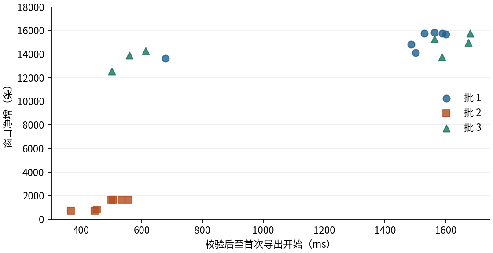

# 源快照工作集：保存点能从旧内存层读回，独立三批因空间不足未启动

**结论：每支约 3.6 万个宿主确认页目前只能判为有条件可复现。** 同一份基线快照恢复五批均达到该量级；另两份独立快照的历史读数在 1.9 万页左右。**40.747 ms 是那份基线快照五批的最小实测余量，不是对新快照的保证，也没有证据说其他快照一定达不到。**

本轮新找到的证据是：诊断批保存时 guest 有 **11,909** 条缓存记录，到首次清单为 **13,605** 条，只净增 **1,696** 条。正常基线快照的保存点计数未直接留存，但由分支证据可给出严格上界 **11,924** 条；故到最小首份清单 28,739 条也至少净增 **16,815** 条。两者保存后至首查的净增长相差**至少 15,119 条**。所以，单纯规定保存前有多少缓存页，不足以控制恢复后的工作集。

## 磁盘止损：三次均未执行

实验盘入口预检（2026-11-21，北京时间 16:38 左右）：可用 65,782,226,944 字节，约 61.26 GiB。原预算 64 GiB 卷 + 20 GiB 宿主保留 + 6 GiB 余量，要求严格大于 90 GiB；当时至少还需增加 30,854,537,217 字节（约 28.74 GiB）。scripts/isolated_storage.py:capacity_budget 返回 ready=False。在第一批创建源沙箱前停止，未开服务、未创建或挂载卷、未删旧卷。

[计划三批 × 七支 × 三时点](planned-runs.csv)：三个计数列留空，表示未运行，不是零。正式三批的分布、批间极差和相对波动**无样本，不能计算**。保存前本应每个源只测一次，再按快照 ID 引用到七支，不能视为七个独立观测。

## 现有存档能补回什么

| 三个目标时点 | 可取得的证据 | 仍缺什么 |
|---|---|---|
| 源保存前 | 两个保留内存层可直接读出**冻结时**的 guest 内核计数。这是保存状态的原始记录，不是保存前一次调用的时刻。基线仅有上界。 | 保存请求之前的独立读数和与冻结之间的时间差；基线没有找到原始内存层副本。 |
| 恢复后、16 MiB 校验前 | 有宿主 restore_end；冻结计数只代表继承起点。 | 到 guest 第一次可执行命令时的 records、generation 和时钟。启动服务可能已运行，不能用保存值填入。 |
| 16 MiB 校验后、暂停前 | **实测代理点**：before.bin 是在这个大窗口内读到的首份清单。基线在校验完成后 356–1,771 ms 才读回，诊断为 439–628 ms；逐支间隔见 CSV。 | 若要区分校验和导出启动，缺的是校验刚结束、上传导出器之前的读数。content_verified 只有时刻；导出器自检虽读过元数据，但随后丢弃，bootstrap.json 不保存计数。 |

上述三个时点测的是 **guest 缓存记录**。是否达到每支 3.6 万页，看四来源按宿主物理页去重后的**确认页**，两个指标不互换。

### 保存点的读数如何校验

对诊断批，只用 debugfs 的只读 cat 读取未挂载的历史 ext4 文件内那一层；对更早的 03:40 UTC 批，读现有归档副本。按各自的 lower-metadata/index.bin 把内存层扇区映射回 guest 内存，核对头、尾、索引及层大小。用对应内核构建目录的 System.map、已记录的内核摘要和 guest iomem 的 Kernel code 起点 0x01000000 定位 asb_pages（guest 物理地址 0x2680c48）、asb_generation、asb_tags 与成员位图。两个源的页计数均同时等于位图置位数和非零标签数；逐个标签均命中对应位图，shmem 标签数也与内核计数一致。这比按内存层文件大小估算可靠。

| 历史系列（UTC 目录简写） | 保存时 guest records / generation | 校验后首份 guest 清单 | 宿主确认页：最小 / 中位 / 最大 |
|---|---:|---:|---:|
| 03:40，旧 provider，唯一完成批 | 11,906 / 11,924（存档实读） | 12,669 | 18,542 / 18,691 / 18,691 |
| 05:59，修复后基线，五批共用同一快照 | ≤11,924 / ≤11,924（上界，非点估计） | 28,739–30,495 | 36,102 / 37,490 / 37,918 |
| 07:43，修复后诊断，一批 | 11,909 / 11,927（存档实读） | 13,605 | 19,498 / 19,535 / 19,553 |

[历史逐支 CSV](archive-branches.csv) 将后置首份实测与缺失的即时计数分列。旧 provider 的失败批没有确认页，不加入统计；两份可直接读取的源仅差 3 条，但**它们都是低页数系列**，不能拿这个极差代表正常基线。作为历史对照，修复后基线 35 支与诊断 7 支各取中位数，差 **17,955 个宿主页**，相对基线中位数低 **47.89%**。这是两份历史快照的描述，不是本轮三批的波动率。

### 分岔点：能定位到保存后，不能再拆成三段

诊断保存状态与七份首清单逐项比较 guest 物理页号和生命周期标签，七支各有 7,811 条继承记录存活。结合 generation 与 records 换算（每成功加入或移除一页，generation 加一；两端无迁移和计数异常），保存到首查每支加入 5,794 页次、移出 4,098 页次。更早的低页数批在相同区间净增 763 条。

基线上界的依据是同一快照恢复出的两个分支，在第 11,925 代给出了不同 guest 页号；这代必定在分叉之后才分配。因此冻结时 generation 至多 11,924，records 不可能高于累计事件数。详见[前轮的具体分支和页号](../page-count-divergence-20261121/REPORT.md)。由此得到报告开头的净增长差下界；它不要求两份快照冻结时页数相同。基线各支串口均见系统服务启动，诊断未见相同输出，支持恢复后的后台读文件是候选解释。缺中间计数，**不能判定净增长具体集中在恢复、16 MiB 校验还是导出准备**，也不能把差额全归于某一服务。

## 最小控制及验证（未执行）

优先把保存条件从“16 MiB 核对完就保存”改为**同一个可观察的 guest 启动里程碑**：例如明确指定并核实所需 systemd 服务均已启动、对应启动作业已结束，再完成原有内容核对并保存，同时记录保存点计数。不要仅按计数凑到 11,900 条或固定睡眠，也不要人为填缓存逼近 3.6 万宿主页。选定里程碑可能形成不同工作集，必须另验是否仍代表目标场景。

恢复条件：原实验目录实际可用空间严格大于 90 GiB。先按用户指定的原配置跑三个独立源、各七支，不在批间改变控制条件；若需试上述里程碑，另作为固定条件的后续对照，不将两组混为三批。每次在源保存前、每支首次可执行命令且尚未校验时、原校验完成后立即读取同一内核记录的 records/generation/shmem、异常计数与起止时刻；继续沿用完整查询记录首份与最终宿主确认页数及墙钟。三点分别以源/分支 ID 和快照 UUID 关联，保留采集自身耗时。比较三段净变化；以每批七支中位数求批间极差，相对波动统一为极差除以三个批中位数的中位数。达到 30,000 页止损线只表示未失败，不代表复现 3.6 万量级。逐批并列正常基准 36,102–37,918、批级去重和最差余量；任一支低于止损线或校验失败即记录并停止。只有新的独立源在相当页数下也获得相当余量，才能讨论跨快照性能。

取证文件：[只读解析脚本](read_saved_counts.py)、[诊断源](archive-diagnostic.txt)、[较早的源](archive-earlier.txt)。两个源分别对应 20261121T074350Z-1581565、20261121T034046Z-1477264。基线为 20261121T055913Z-1546158，外层 result.json 的 cleanup.successful_fixture_removed=true；保存的索引不是层内容。

## 三次实测

**三份独立源快照，三批均通过，21/21 支完成。约 3.6 万宿主确认页能在新快照复现，但不能保证每份快照都达到：第 1、3 批为高位，第 2 批七支均低于 24,000 页。** 保存前的源计数仅差 50 条，最大的分岔发生在 **16 MiB 校验结束到首份 guest 清单发布之间**，不是保存前。

| 批 | 保存前源清单 | 保存前串口已见 getty slice / 已见 Snap Daemon 启动完成 | 每支宿主确认页（最小 / 中位 / 最大） | 批级去重页 | 派发至批级结果 ms / 余量 ms | 开跑前 → 收尾后可用 GiB |
|---|---:|---|---:|---:|---:|---:|
| 1 | 11,956 | 否 / 否 | 36,508 / 36,676 / 36,757 | 165,702 | 899.673 / 100.327 | 125.247 → 124.990 |
| 2 | 11,924 | 是 / 否 | 22,691 / 23,436 / 23,625 | 57,627 | 704.572 / 295.428 | 124.990 → 124.745 |
| 3 | 11,906 | 否 / 否 | 36,592 / 36,704 / 36,795 | 165,650 | 955.318 / 44.682 | 124.745 → 124.487 |

每批新建源、按原流程预热并保存一次，再由七个新沙箱恢复。三批的源 ID、快照名均不同。与 cad1058 相同的固定镜像、内核、修复版 provider、14 个前置探针、两遍查询、16 MiB 内容核对与 NumPy 去重；未加等待条件。唯一取消的停止条件是本测量模式下的低页数，原五批入口仍保留原条件。三次各自通过身份与清理检查，成功卷已由平台回收，File exists 均为 0；无失败、无重跑。

### 三个时点与净变化

每项均基于实测，单位为 guest 缓存记录条数。时点列为批内中位数；净变化列为**先逐支相减，再取七支中位数**，不能简单用中位数列相减。每个源的保存前计数只读一次。[21 支实测 CSV](three-branches.csv) 列出每支三时点、第四个既有首份清单、净变化、计数起止时间、代次和宿主确认页。[逐批分布 CSV](three-runs.csv) 给出每列的最小、中位与最大值。

| 批 | 保存前 | 恢复后校验前 | 校验后 | 首份导出 | 保存→恢复后净增 | 校验期间净增 | 校验后→首份净增 |
|---|---:|---:|---:|---:|---:|---:|---:|
| 1 | 11,956 | 11,987 | 13,794 | 29,376 | +31 | +1,784 | +15,671 |
| 2 | 11,924 | 14,104 | 14,104 | 15,748 | +2,180 | 0 | +1,644 |
| 3 | 11,906 | 11,960 | 15,026 | 29,292 | +54 | +2,389 | +14,266 |

**如何测。** 在原有 guest Python 命令中读 /proc/asb_pagecache，校验头部、完整长度与错误计数。源在原写入、fsync 和读回之后采一次，再提交保存；恢复支在原校验代码执行之前和最终读回成功之后各采一次，不增加单独的 guest 命令往返。恢复后读数是该命令能执行探测代码时的读数，不是虚机恢复瞬间。采集本身需要 CPU 和读取元数据；三批采用相同方法。保存请求前只读源串口当时已有的输出，不等待 getty 或 snapd；“否”指尚未看到指定日志，不是断言进程不存在。

### 批间波动与分岔点

按事先约定，用三个批内中位数的极差除以这三个值的中位数。源计数每批只有一个值；批级并集也直接按三个实测值比较。

| 指标 | 批间极差 | 相对波动 |
|---|---:|---:|
| 保存前 guest 记录 | 50 | 0.419% |
| 恢复后、校验前 guest 记录 | 2,144 | 17.886% |
| 校验后 guest 记录 | 1,232 | 8.735% |
| 首份导出 guest 记录 | 13,628 | 46.525% |
| 每支宿主确认页 | 13,268 | 36.176% |
| 批级去重页 | 108,075 | 65.243% |

**第 2 批恢复后反而领先，但校验后到首份清单只新增 712–1,644 条，另外两批的每一支都至少新增 12,537 条。** 这个区间包含导出器准备、绑定、调度与 guest 后台活动。以 guest 时钟计，校验后读数结束至首次导出开始的批内中位间隔分别为 1,529、500、1,563 ms。因此测到了分岔所在的窗口，但没有把“窗口更长”和“单位时间内加载更多页”分开，也不能仅凭三份串口样本把差额归给某个服务。

**对 1 秒余量的含义。** 原来的 40.747 ms 仍只是旧五批的最小实测余量，但高工作集下低于 1 秒的现象不只属于旧快照：两个新高位批分别余 100.327、44.682 ms。它们的批级并集略小于旧五批的 168,832–172,364 页。低位批 295.428 ms 的余量不是高工作集性能证据。三批说明可能复现，不构成未来最差余量保证。

本地总回执：.artifacts/variance-three-HEeU7R8q/space.txt、1.log 至 3.log。三次平台目录分别为 .artifacts/storage-isolated-service/ 下的 20261121T105703Z-1623810、20261121T105903Z-1627858、20261121T110101Z-1631917；guest-cache/result.json 保存源计数与串口状态，guest-cache/try-1/result.json 保存逐支计数、查询与合并时刻，外层 result.json 记录清理。复算入口为 summarize-three.py，传总回执目录；无需启动服务。

下一步建议（未执行）：若目标是复现高工作集，先用这 21 支已存数据按“校验后到首份发布间隔”分组比较净增条数，再决定是否需要单独控制首查时刻。仅以保存前页数相近作为控制条件，在本轮已经不足。

## 窗口与净增的关系

**建议控制首查时刻，目的是让不同源快照在相同等待条件下可比，不是靠等够某个毫秒数取得 3.6 万页。** 最有区分力的是两个约半秒的观测：第 2 批第 4 支在 500.125 ms 内净增 1,644 条，最终确认 23,436 页；第 3 批第 4 支在 502.168 ms 内净增 12,537 条，最终确认 36,719 页。只差 2.043 ms，结果却分属低位和高位。

横轴是同一 guest 单调时钟上的“校验后计数读取结束 → 首次导出开始”，不是首份在宿主读回的时刻；纵轴是首份条数减去校验后条数。两端读数各有读取窗口，因此“条/ms”是整窗平均净增，不是每毫秒观测到的瞬时速率。三个源各有七支，不能把 21 个点当作 21 份独立快照。[逐支散点、速率、拟合残差与串口对时](window-relation.csv)，输入为本节前的 three-branches.csv、three-runs.csv 及对应恢复支已存串口日志。

### 1–2. 窗口越长通常净增越多，但第 2 批不只是窗口短

下表为**换算**。四分位数按逐支速率线性插值；批中位数不是两个批中位数相除。Pearson 衡量线性相关，Spearman 衡量排序相关。

| 观测 | Pearson r | Spearman ρ | 平均净增速率：中位 [Q1, Q3]（条/ms） | 速率全范围 |
|---|---:|---:|---:|---:|
| 全部 21 支 | 0.781 | 0.875 | 9.41 [3.25, 10.13] | 1.60–24.97 |
| 第 1 批 | 0.769 | 0.643 | 9.96 [9.85, 10.22] | 9.41–20.12 |
| 第 2 批 | 0.871 | 0.896 | 2.95 [1.86, 3.17] | 1.60–3.29 |
| 第 3 批 | 0.716 | 0.714 | 9.77 [9.16, 24.08] | 8.66–24.97 |

**判据与推断：** 如果三批只是读取窗口长短不同、以相近平均速率增长，除以各自窗口后速率应当接近。实测换算后，第 2 批**最高**速率 3.29 仍低于另两批**最低**的 8.66；再看上面的等时长对照，结论是第 2 批既短，整窗净增速率也低。按批分别减去窗口和净增的均值，合并后的 Pearson r 仍为 0.708。相关性存在，但不能据此认定人为多等 1 ms 会增加固定数量的记录。

### 3. 校验期间能对上启动事件，不能归因给某个服务

先区分两种统计口径：题中的三批 +1,807 / 0 / +3,066 是“校验后批中位数 − 校验前批中位数”；同一支前后相减再取批中位数是 **+1,784 / 0 / +2,389**。批 2 七支净增都为零，但每支 generation 都增加 8,192；按内核每次加入或移出各增加一代的规则，换算为各加入、移出 4,096 页次，不是缓存没有活动。

逐支读 service-logs/serial/<sandbox_id>/firecracker-stdout.log，用带秒数的 guest 内核日志与同支校验前计数结束、校验后计数开始作启动相对时间对照。**Started Journal Service**（系统日志服务启动完成）的时间戳在批 1、3 各 7/7 支均落入校验窗口，例如批 1 第 1 支为 0.872715 s，对应窗口 0.795755–1.053430 s。批 2 的恢复串口 0/7 有此行。getty slice 则不一致：批 1 有 2 支在窗内、5 支在窗前，批 3 全在窗前；批 2 在源保存前已见该标志。Snap Daemon 在批 1、3 恢复串口各 7/7 出现启动完成行，但该行无数值时间戳，批 2 的恢复串口没有此行。

**能对上的是启动阶段，不是页的来源。** 串口打印时刻不是文件加入缓存的时刻；没有日志也不等于服务没运行。没有同窗服务读量或页级来源，具体服务对校验净增的贡献**无法归因**。

### 4–5. 首份清单能估算确认页，不能据此给出最短等待时间

**换算：** 以首份条数 X 拟合宿主确认页 Y，21 支普通最小二乘为 **Y ≈ 0.96361 X + 8,409.46**，R²=0.99984。观测残差（实际减拟合）为 **−216 至 +93 页**，均方根误差 79 页。它是这三批工作集的经验换算，不是归属或去重公式。X 只覆盖低段 14,816–15,748 和高段 29,159–29,558，中间无样本；两个相距很远的簇抬高了 R²。用两个高批拟合再预测留出的低批，会高估约 6,703–7,202 页，这是超出训练区间的反例。

把 36,000 页代回并计入上述观测残差，得到约 **28,536–28,856 条**的首份清单区间。它位于两个观测簇之间，是**插值推算**，不是实测门槛或预测置信区间。再从条数反推时间，关系不稳定：

- **实测**达到 36,000 页的 14 支，窗口落在 **502–678 ms**（4 支）或 **1,486–1,680 ms**（10 支）；未达到的 7 支为 **367–557 ms**。成功和失败时长重叠，且没有观测每支何时首次跨过目标。
- **有条件推算**：如果强行假定每支从校验后一直按自己的端点平均速率匀速净增，以 (28,632 − 校验后实测条数) / 该支速率换算，高位两批给出约 **476–1,603 ms**，低位批给出 **4,420–9,079 ms**。后者全部超出 21 支的最长观测窗口，且没有证据说明净增会持续。两个区间都不能用作调度下限。

所以可报告的是**见过高位的时长范围**，不是“至少等 502 ms”，更不是延后到 1.5 秒即可保证达标。

### 6. 如何控制首查而不把等待误当成原因

**现有记录不能区分匀速增长和阶梯增长，也不能分离等待本身与同期后台活动。** 每支在目标窗口只有起止两个计数；批 2 重复出现 +712、+1,644 只说明端点相近，不能还原中间路径。高位批和低位批来自不同源，后台活动也没有随机分配。

**下一步建议（未执行）：控制读取机会，不控制结果。** 在每个新独立源内，把七支随机分配到约 **0.5 s / 1.5 s** 两档，以各支校验后计数结束为起点；跨源轮换分配。记录计划与实际 guest 窗口，导出器未就绪造成的超窗单列，不把目标延时写成实测，也不等待页数达标。保留七支身份、16 MiB 校验、暂停及四来源去重。验收看**同源**两档的净增、首份清单与最终确认页范围，再看**同档跨源**的差额；保留低位支，不用本轮拟合值代替实测。如果还要判断增长形状或服务贡献，另在同一窗口取得至少一个中间计数、带时间戳的服务启动和进程读量，并记录采集扰动。没有这些证据，不把固定延时当作复现高工作集的充分条件。
