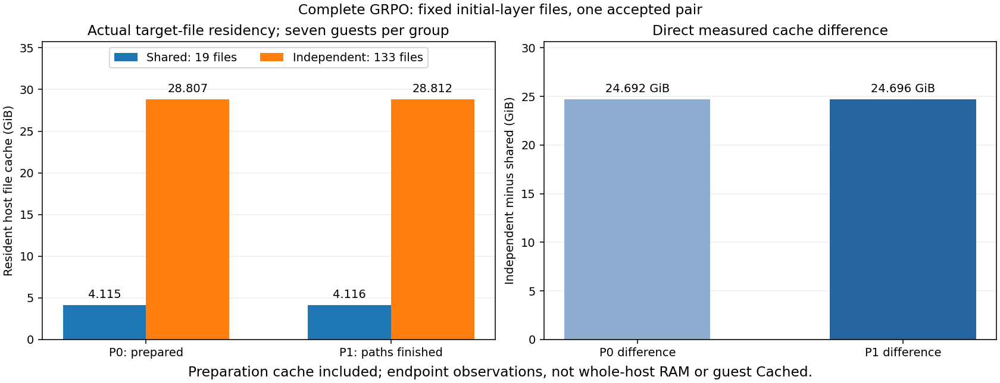
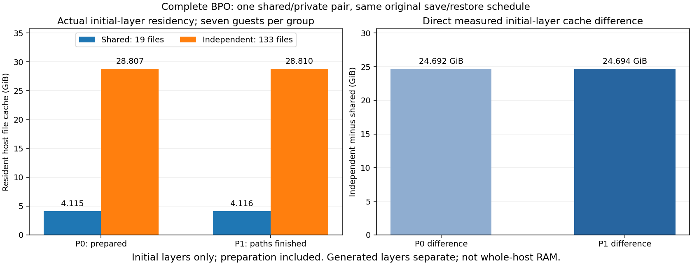

# 指定共享文件的host缓存收益

Prettier #6604的完整GRPO和BPO各完成一对对照：每组一个私有服务、七个沙箱，共546个实际动作。共享组使用19个相同初始文件，每文件7个使用者；独立组使用7套普通副本，共133个不同文件，每文件1个使用者。来源、顺序和长度一致，原始19文件长度合计5,565,854,720字节。

GRPO让七条路径从头执行，单组189动作；BPO在原第11、24步保存并恢复分支，单组84实际动作。本次是冻结工具轨迹的调度重放，不是GRPO／BPO模型训练效果比较。

## 实际驻留及准备阶段影响

单位MiB（2^20字节）；1 GiB＝2^30字节，驻留页大小4096字节。

| 调度／阶段 | 共享19文件 | 独立133文件 | 独立减共享 |
| --- | ---: | ---: | ---: |
| GRPO P0 | 4214.035156 | 29498.246094 | 25284.210938 |
| GRPO P1 | 4215.144531 | 29503.503906 | 25288.359375 |
| BPO P0 | 4214.035156 | 29498.246094 | 25284.210938 |
| BPO P1 | 4215.117188 | 29501.542969 | 25286.425781 |

P0为普通复制并同步自有文件系统之后、guest创建之前；P1为全部原路径结束、官方检查及删除之前。查询顺序和实际使用关系经过核对，副本没有被恢复配置重新合并。

| 调度 | P1减少/GiB | 减少比例 | 运行期间差值再增/MiB | 动作/对 |
| --- | ---: | ---: | ---: | ---: |
| GRPO | 24.695663 | 85.713071% | 4.148438 | 378 |
| BPO | 24.693775 | 85.712214% | 2.214844 | 168 |

公式：`D0=独立P0−共享P0`，`D1=独立P1−共享P1`，`减少比例=D1/独立P1`，`运行期间差值再增=D1−D0`。这是实际独立副本对照，不是单沙箱结果乘7。





两幅图左侧是共享／独立的实际驻留，右侧是差值。主要收益在准备时已形成；不能把24.7 GiB写成工具运行新产生的收益。每种调度只有一对，不能给出重复均值或标准差，也不能把两行相减当作BPO相对GRPO的优势。

## BPO生成层不并入主收益

P0生成层尚未创建，容量为空而非0。P1第11步层有7个使用者，驻留共享9.179688／独立9.007813 MiB；第24步层有4个使用者，驻留0.550781／0.582031 MiB。生成内容和大小不同，分别记录。最终全部lower为21／135个，主比较仍只含初始19／133文件。

## 测量成本和结论边界

| 调度 | 共享全部驻留查询/秒 | 独立全部驻留查询/秒 |
| --- | ---: | ---: |
| GRPO | 0.346159 | 2.337045 |
| BPO | 0.377868 | 2.304801 |

含P0、P1，BPO另含生成层查询。这里是查询墙钟成本，不是任务减速率；本次没有同版本完整副本模式关闭采样对照。复制、同步和原任务执行另有成本。

mincore查询指定普通文件的host全局缓存驻留；它不等于本实验cgroup的file记账，也不等于guest Cached在host中的物理页。结果不包含guest RAM、匿名内存、其他文件、内核全部开销或整个host物理节省。旧记账差额不当作节省，也不补为0。

四组的重放／恢复、对象关联、测量和清理通过；原模型任务的官方测试仍为每实例0通过、2失败。GRPO共享成功组被续跑结果复用，原独立准备同步超时及原成对FAIL仍保存在本地；没有改写为首次运行成功。BPO一对一次完成。

## 随包证据可复算什么

[脱敏样例](../../examples/host-copy-summary/README.md)保留每个对象的身份、驻留页数、使用者、查询成本及任务结果摘要，能校对本页所有主数值及公式。完整轨迹、运行日志、镜像、数据库和guest／host持续曲线原始点不随包分发，因此它不能重新独立验证所有原任务动作或服务清理。两张图来自已通过的原实验。

```bash
bash scripts/report-host-copy-summary.sh --example --output .artifacts/public-report
```
